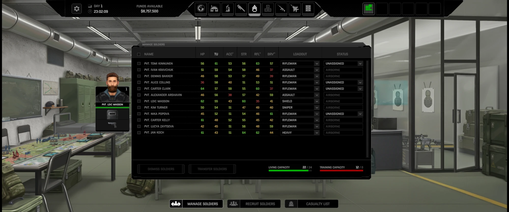

# Multi-Column Sort (Xenonauts 2 mod)

Adds extra sort levels to the soldier lists, the way spreadsheet grids do.

- **Ctrl-click** a column header (Cmd-click or Shift-click also work) to add it as the next sort level.
  The header gets a small marker with its position and direction, such as `2▼`.
- Ctrl-click it again to reverse that level, and a third time to remove it.
- A normal click on any header goes back to the game's single-column sort.

Example: click STATUS, then Ctrl-click ACC. Soldiers are grouped by status and, inside each group,
ordered by accuracy.

Works on Soldiers > Manage, Recruit and Memorial, and in the dropship soldier picker. If
[Soldier Total Stats](https://github.com/reuvab/xenonauts2-soldier-total-stats) is installed, its TOT
column can be a sort level too.

Two soldiers count as equal on a number column when they show the same rounded value.
In the dropship picker, extra levels need a real column as the first level: click a header first.

## Troubleshooting

The mod writes `MultiColumnSort.log` in the game's user data folder (next to `Mods`). It records each
screen it attached to and every modifier-click.

## Building from source

Set `XENONAUTS2_MANAGED` (the game's `Xenonauts2_Data/Managed` folder) and `XENONAUTS2_MODS` (the game's
`Mods` folder) in a `local.env` file in this folder or its parent.

| Script | What it does |
| --- | --- |
| `./build.sh` | Builds the DLL into `mod/assembly/common/` |
| `./deploy.sh` | Mirrors `mod/` into the game's `Mods/MultiColumnSort` folder |
